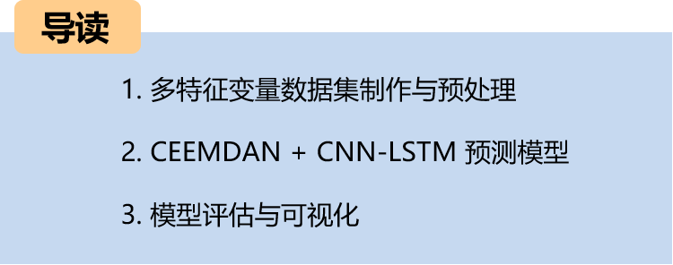
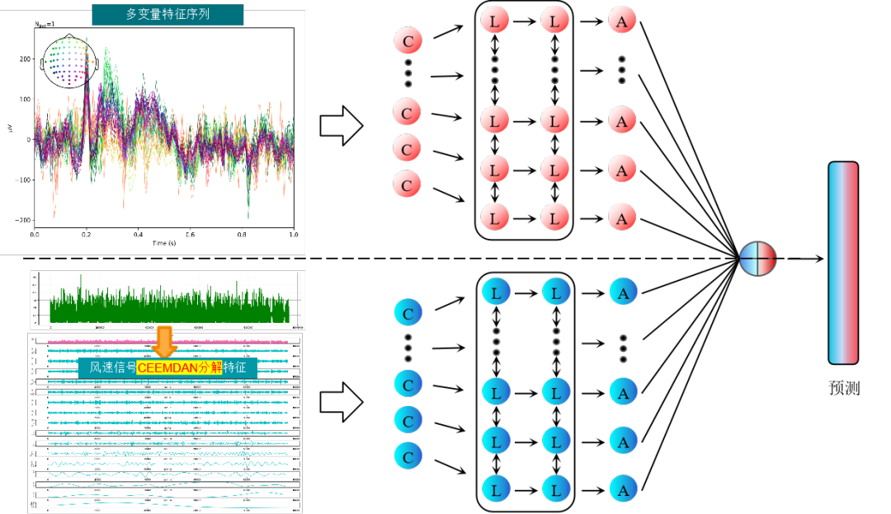
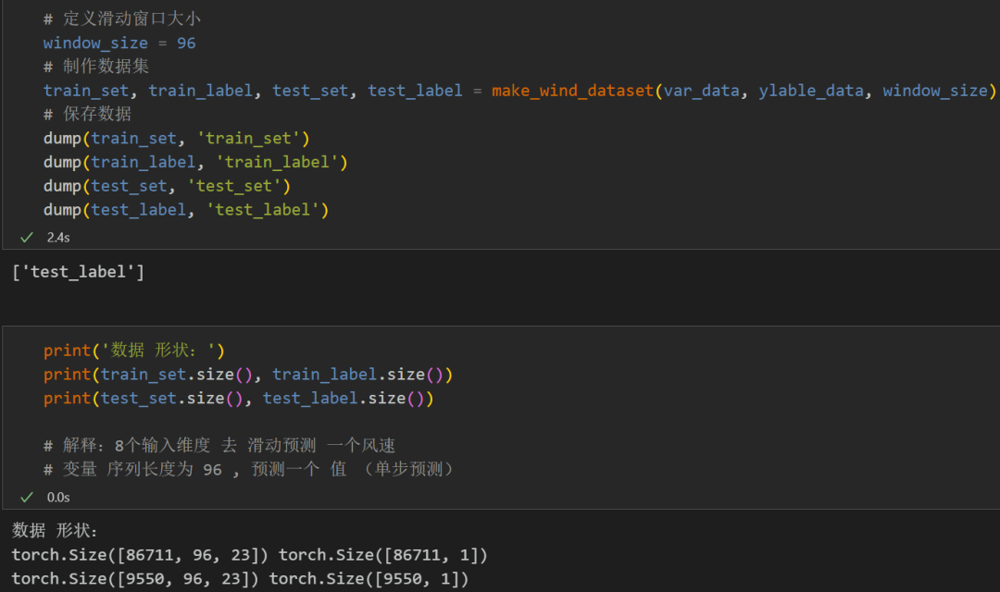
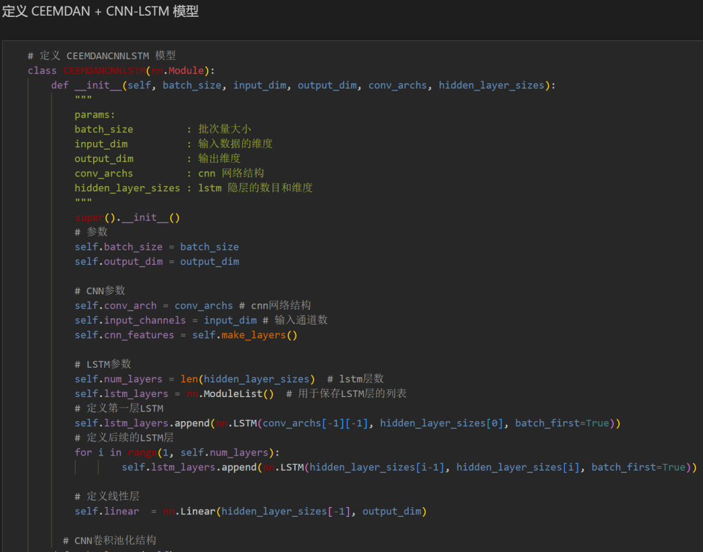
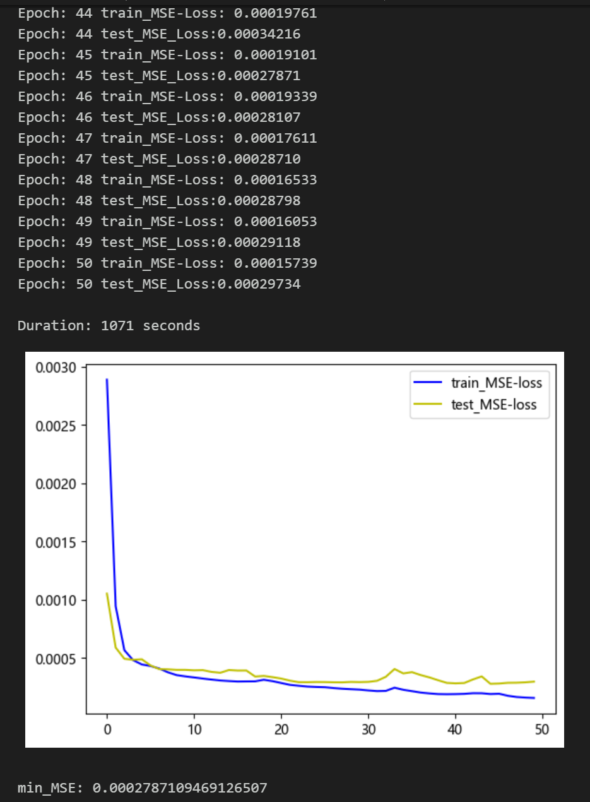
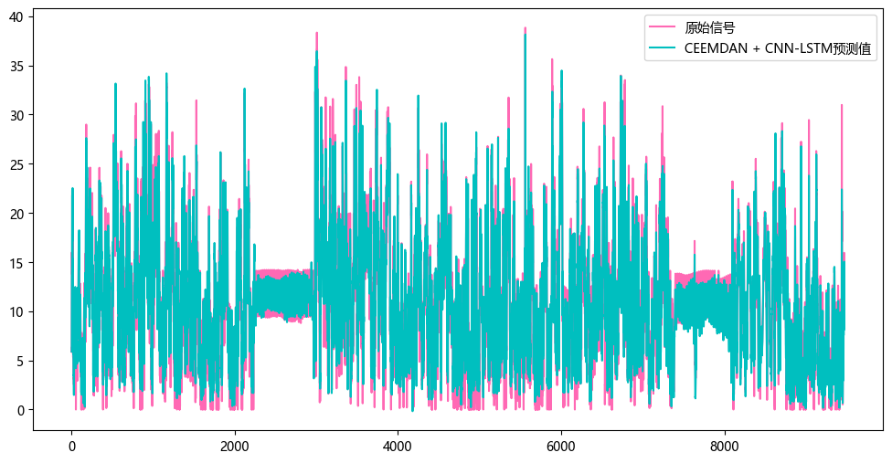
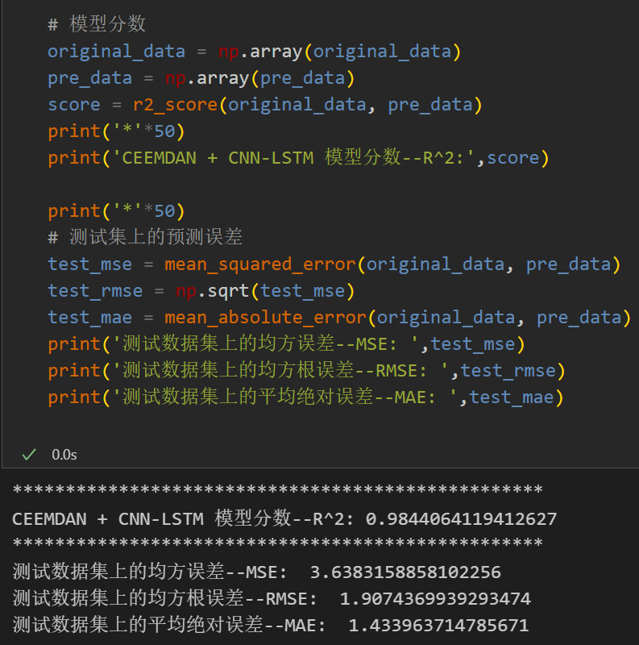
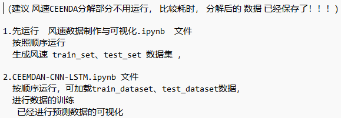
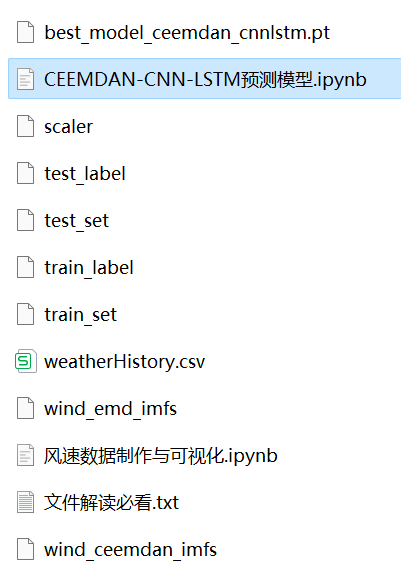

# Multi-feature Variable Sequence Prediction (5) CEEMDAN+CNN-LSTM Wind Speed Prediction Model

Single variable includes the following content:
Including wind speed data, as well as the already generated and prepared wind speed dataset and label set, corresponding codes can be run.
The CEEMDAN+CNN-LSTM model has achieved smaller MSE and MAE, showing particularly significant improvements in performance!
Includes data preprocessing code, CEEMDAN decomposition code, complete CEEMDAN+CNN-LSTM model prediction code, visualization code.
Preface
This paper introduces a multi-feature variable sequence prediction model, CEEMDAN + CNN-LSTM, based on the preliminary introduced wind speed data (dataset attached at the end of this article), to enhance the predictive performance of time series data.
\t  
The overall structure of the model: The dataset consists of nine variables including weather, temperature, humidity, pressure, and wind speed. The CEEMDAN algorithm is used to decompose the wind speed sequence. All components are then combined with the original dataset variables to form an enhanced feature input. A sliding window is created to create the dataset, and multivariate prediction for wind speed is achieved. Initially, convolutional pooling operations are performed on CNN to extract spatial features from the feature variables, increasing dimensionality and shortening the sequence length. Subsequently, these features are fed into an LSTM layer to extract temporal features, thereby realizing a CNN-LSTM predictive model.
\t  
LSTF (Long Sequence Time-Series Forecasting) issues refer to the need to handle long sequences in time series forecasting. In practical applications, time series may contain a very large number of data points. Under these circumstances, traditional time series forecasting models might encounter some challenges due to issues that arise when processing long sequences, such as:
Long-term dependency: As time series data grows, the model needs to be able to capture long-term dependencies and trends.
\tComplexity of computation: Training and prediction for long sequences typically require more computational resources and time.
Memory Consumption: Long sequences typically require a significant amount of memory to store data and model parameters, which can lead to memory exhaustion or performance degradation.
When dealing with LSTF problems, selecting an appropriate window size (window size) is crucial. Selecting the right window size can help the model better capture patterns and features in time series, and for extracting longer dependencies in the sequence, this paper increases the window size to 96 and employs a CNN-LSTM model to fully extract feature information from the sequence.
1 Data Preparation and Preprocessing for Multi-Feature Variables
1.1 Import Data
1.2 CEEMDAN Decomposition
1.3 Data Preparation and Preprocessing
Firstly, merge the original data variables and decomposed components, and divide the training set and test set at a ratio of 9:1
Create the dataset
2 Pytorch-based CEEMDAN + CNN-LSTM Prediction Model
2.1 Define the CEEMDAN + CNN-LSTM Prediction Model
Note: The input wind speed data shape is [256, 96, 23], batch_size=256, where 96 represents the sequence length (the sliding window takes values), and the dimension 23 represents the dimensions of the selected 8 variables and 15 components.
2.2 Set parameters and train the model
Train the model for 50 epochs, MSE is 0.0002787, the multi-variable feature CEEMDAN + CNN-LSTM prediction effect is good. After adding CEEMDAN decomposition, the multi-variable prediction effect has been significantly improved, and the performance is superior. By adjusting the model parameters appropriately, further improvement in model prediction performance can be achieved.
Note on parameter adjustments:
Adjustable parameters include:
- Increase the number of CNN layers and hidden layer dimensions, fine-tuning the learning rate;
- Adjust the number of LSTM layers and dimensions, increasing more epochs (note to prevent overfitting)
\tThe sliding window length can be changed (set an appropriate window length).  
3 Model Evaluation and Visualization  
\t3.1 Results Visualization  
\t3.2 Model Evaluation  
\n        \n

## Images

<!-- PAYMENT_BLOCK -->

## Get this dataset

- Payment link (Stripe): [Buy now](https://buy.stripe.com/3cs8yP7sY87d0vu9AB)
- Payment QR code: 

<!-- /PAYMENT_BLOCK -->
